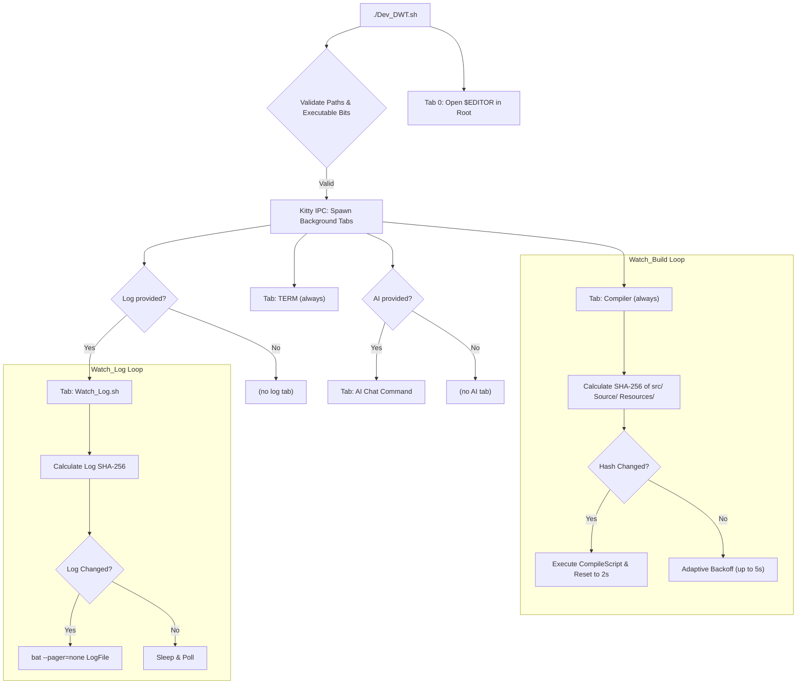

( AI is used in this project, Usage note is at the end !)

# kitty-dev-harness 🚀

A zero-bloat, language-agnostic development workspace orchestrator for [Kitty](https://sw.kovidgoyal.net/kitty/). 

Spins up a complete, tabbed terminal IDE environment in milliseconds—complete with an **adaptive SHA-256 file watcher**, **live syntax-highlighted log stream**, and your favorite terminal editor.

---

## Features

* **Instant Multi-Tab Orchestration:** One command launches your Shell, Auto-Compiler, Live Log Viewer, optional AI Chat, and Editor into organized, named Kitty tabs.
* **Adaptive SHA-256 File Watching:** Watches source trees for changes using cryptographically accurate checksums.
  * Scans `./src/`, `./Source/`, and `./Resources/` for file changes.
  * Automatically backs off from 2s to 5s when idle to save CPU cycles.
  * Avoids `inotify` buffer overflow, pipe deadlocks, and false triggers caused by atomic swap-file writes in Neovim/VS Code.
  * Plus my Compile Script needed gum to work so I had to manually concoc this mess
* **Live Cool Logs:** Used With bat, it automatically clears the screen on Log Tab whenever changes occur without locking file descriptors.
* **Editor & Language Agnostic:** Works with **Neovim, Helix, Vim, Micro, or Nano**, and any language that can run a build script (`dotnet`, `cargo`, `make`, `gcc`, `zig`, `go`).
* **Optional AI Chat Tab:** Spawn a tab running any CLI chatbot (e.g. `agy`, `gemini`) alongside your workspace with `-ai`.
* **Defensive Shell Design:** Full POSIX flag parsing (`-r`, `-c`, `-l`, `-e`, `-n`, `-ai`), executable bit validation (`-x`), path checks, and clean exit codes.

---

## Workspace Layout

When launched, your Kitty window is organized into up to 5 dedicated tabs:

```
┌──────────────────────────────────────────────────────────────────────────────────────┐
│                                                                                      │
│                                                                                      │
│                                      $EDITOR .                                       │
│                              (Neovim / Helix / etc.)                                 │
│                                                                                      │  
├──────────────────────────────────────────────────────────────────────────────────────┤
│ [Project | Editor] [Project | TERM] [Project | Compiler] [Project | Log] [Proj | AI]│
└──────────────────────────────────────────────────────────────────────────────────────┘
```

* **Editor Tab:** Automatically sets the Kitty window title and opens your editor inside the project root.
* **Terminal Tab:** A clean shell ready for ad-hoc commands, Git, or running tests.
* **Compiler Tab:** Runs `Watch_Build.sh`—watches `src/`, `Source/`, and `Resources/`, triggering your compile script upon file change.
* **Log Tab** *(Optional)*: Runs `Watch_Log.sh`—tails your log file and displays updates cleanly using `bat`. Only spawned if `-l` is provided.
* **AI Chat Tab** *(Optional)*: Spawns a tab running your chosen CLI chatbot. Only spawned if `-ai` is provided.

---

## Prerequisites

Ensure you have the following installed on your system:

* **Kitty Terminal**
* **bat** (for syntax-highlighted log streaming):
  ```bash
  # Arch / EndeavourOS
  sudo pacman -S bat
  # Ubuntu / Debian
  sudo apt install bat
  # Fedora
  sudo dnf install bat
  ```
* **Coreutils** (`sha256sum`, `find`, `sort`, `cut` — standard on all Linux distros)

* **NOTE** CompileScript provided requires GUM as MY compile script uses it, youre a big boy now, you can edit it out.

> [!NOTE]  
> Kitty must allow remote control. Ensure this line is present in `~/.config/kitty/kitty.conf`:  
> ```conf
> allow_remote_control yes
> ```

> [!IMPORTANT]
> `Watch_Build.sh` requires both a `src/` **and** a `Resources/` subdirectory to exist inside your project root at startup, or it will exit with an error.

---

## Installation & Setup

1. **Clone the repository:**
   ```bash
   git clone https://github.com/Jussstrollin/Kitty-Dev-Env.git
   cd Kitty-Dev-Env
   ```

2. ** READ THE SOURCE FILE, you should learn to read for malicious things. **

3. **Make scripts executable:**
   ```bash
   chmod +x *.sh
   ```

4. *(Optional)* Add to your `$PATH` or create a convenient alias:
   ```bash
   ln -s "$(pwd)/Dev_DWT.sh" ~/.local/bin/dev-harness
   ```

---

## Usage

```bash
./Dev_DWT.sh -r <PROJECT_ROOT> -c <COMPILE_SCRIPT> -e <EDITOR> [-l <LOG_FILE>] [-n <NAME>] [-ai <COMMAND> <SESSION_ARGS>]
```

### Options

| Flag | Argument | Description | Required? |
| :--- | :--- | :--- | :---: |
| `-r`, `--Root` | `/path/to/project` | Absolute path to your project root | **Yes** |
| `-c`, `--CompileScript` | `/path/to/build.sh` | Absolute path to your executable compile script | **Yes** |
| `-e`, `--Editor` | `nvim` / `hx` / `vim` | Terminal editor command (must be in `$PATH`) | **Yes** |
| `-l`, `--LogFile` | `/path/to/Latest.log`| Absolute path to your application's output log | No |
| `-n`, `--Name` | `"MyProject"` | Custom prefix for Kitty tab titles (Default: `Project`) | No |
| `-ai`, `--AI` | `<command> <args>` | CLI chatbot command + session args to open in a dedicated AI tab | No |
| `-h`, `--help` | — | Display the help menu and exit | No |

---

### Example

How i Use mine (its shoved in an alias in zsh):

```bash
./Dev_DWT.sh \
  -r /home/user/Projects/DefenseWithTowers \
  -c /home/user/Projects/DefenseWithTowers/Compile.sh \
  -l /home/user/Projects/DefenseWithTowers/Latest.log \
  -e nvim \
  -n "DWT"
```

With an AI tab (e.g. resuming an AGY conversation):
```bash
./Dev_DWT.sh \
  -r /home/user/Projects/DefenseWithTowers \
  -c /home/user/Projects/DefenseWithTowers/Compile.sh \
  -e nvim \
  -n "DWT" \
  -ai agy --conversation=3c374e40-b3a0-493d-a4a5-f413d0e11f08
```

---

## How It Works (Behind the Scenes)



---

## License

This project is open-source and available under the [MIT License](LICENSE).

---

## Acknowledgements :
Big thanks for the creator and maintainers of [bat](https://github.com/sharkdp/bat/) for providing such a cooler cat.

While not directly used in this project, another thanks to the creator and contributors of [gum](https://github.com/charmbracelet/gum) for such a noob friendly Terminal UI creation.

And lastly, for the creator and maintainers of [Kitty](https://sw.kovidgoyal.net/kitty/) for making a noob friendly IPC controls thingy.

---

## Ai usage :
    I WROTE almost all the lines, AI, more specifically AGY : Gemini (HIGH), is there to glaze and trash talk me for making mistakes (provide correction) alongside common mistakes/things overlooked.
    
    tho, It did write the majority of this README, im way too lazy to document this. but i did add corrections here and there.
